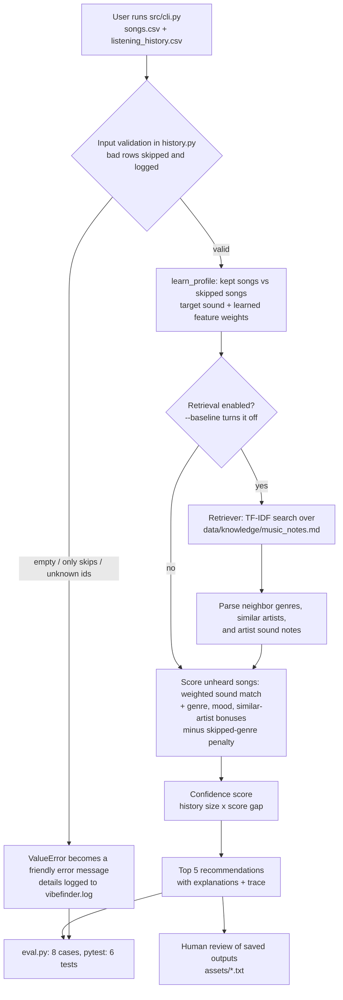

# 🎵 VibeFinder 2.0: A History-Aware Music Recommender with RAG

VibeFinder 2.0 learns a listener's taste from their **listening history** (likes, replays, full plays, and skips), retrieves **notes about artists and genres** from a small knowledge base, and recommends songs they haven't heard yet, with a plain-language reason for every pick. It matters because real music taste is shown by behavior, especially by what you skip, not by a hand-typed "I like pop" profile.

## Original project

This extends **VibeFinder: Music Recommender Simulation** (Module 3, CodePath AI110). The original was a content-based recommender: a hand-written listener profile (for example "High-Energy Pop") was scored against a 20-song catalog using weighted features (genre, mood, energy, tempo, valence, danceability, acousticness), and it returned a ranked top 5 with an explanation for each score. Its limits were that the weights were fixed by hand, it never learned from behavior, and it had no outside knowledge about artists. The original model card is kept in `assets/model_card_module3.md`.

## What's new in 2.0

- **Learning from listening history** (`src/history.py`): kept songs define a target sound, and features that separate kept songs from skipped songs get higher weights. Songs the user already heard are never recommended again.
- **Retrieval-augmented recommendations** (`src/retriever.py`, `src/pipeline.py`): a TF-IDF retriever searches `data/knowledge/music_notes.md` (16 genre notes + 12 artist notes). Retrieved text changes the scores (similar-artist bonus, neighbor-genre bonus) and is quoted in the explanations.
- **Expanded catalog**: 44 songs, including 24 tracks from Daniel Caesar, Cleo Sol, Kanye West, Aretha Franklin, Beres Hammond, Lauryn Hill, Beyonce, Snoh Aalegra, Frank Ocean, Drake, Kendrick Lamar, and J Cole.
- **Reliability**: input validation, logging to `vibefinder.log`, a confidence score, an evaluation harness (`eval.py`), and unit tests.
- **Baseline switch**: `--baseline` turns retrieval off so the effect of RAG can be compared directly.

## Architecture overview

The diagram source is in [`diagrams/architecture.mmd`](diagrams/architecture.mmd).



Data flows top to bottom: the CSV files are validated, a taste profile is learned, retrieval (optional) adds knowledge from the notes, every unheard song is scored, a confidence value is computed, and the top 5 are printed with reasons. Humans check the saved outputs in `assets/`, and `eval.py` plus `pytest` check behavior automatically.

## Setup

No API key is needed. Everything runs offline.

```bash
git clone https://github.com/Lia2w8rld/applied-ai-system-final.git
cd applied-ai-system-final
python3 -m venv .venv && source .venv/bin/activate   # optional
pip install -r requirements.txt
python3 -m src.cli              # recommendations with retrieval
python3 -m src.cli --baseline   # same, with retrieval disabled
python3 eval.py                 # evaluation harness (8 cases)
pytest                          # unit tests (6 tests)
```

To use your own data, edit `data/listening_history.csv` (columns `song_id,action`; actions are `like`, `replay`, `full_play`, `skip`) or add rows to `data/songs.csv` and notes to `data/knowledge/music_notes.md`.

## Sample interactions

All outputs below are real runs; full versions are in `assets/`.

**1. Recommendations for the sample history** (`python3 -m src.cli`). The history has likes and replays on Daniel Caesar, Cleo Sol, Snoh Aalegra, Frank Ocean, Aretha Franklin, and Lauryn Hill, and skips on *HUMBLE.*, *One Dance*, *Hotline Bling*, *Gold Digger*, *Sunrise City*, and *Love On Top*.

```
Learned feature weights (higher = better predicts what you keep vs skip):
  energy: 1.50
  valence: 1.02
  danceability: 1.37
  acousticness: 1.75

=== VibeFinder 2.0 (with retrieval) (confidence 0.62) ===
1. Get You - Daniel Caesar [r&b, romantic] score 10.79
     - sound match 94% to what you keep playing
     - you often keep r&b
     - mood 'romantic' matches songs you keep
     - Daniel Caesar is similar to artists you replay (from notes)
     - about Daniel Caesar: gospel-tinged falsetto, slow romantic ballads, sparse arrangements
2. I Want You Around - Snoh Aalegra [r&b, moody] score 10.56
     - sound match 90% to what you keep playing
     - you often keep r&b
     - mood 'moody' matches songs you keep
     - Snoh Aalegra is similar to artists you replay (from notes)
     - about Snoh Aalegra: cinematic, moody, smoky vocals, slow burn
3. Why Don't You - Cleo Sol [neo soul, romantic] score 10.38
     ...
```

**2. Baseline vs. retrieval** (output of `eval.py`). Retrieval changed 1 of 5 picks:

```
baseline : ['Get You', 'I Want You Around', "Why Don't You", 'Nights', 'Library Rain']
retrieval: ['Get You', 'I Want You Around', "Why Don't You", 'Nights', 'Chain of Fools']
```

Without notes, the fifth pick is a quiet lofi track that only matches on sound. With retrieval, Aretha Franklin is recognized as similar to artists the listener replays (Lauryn Hill, Beyonce, and Beres Hammond are linked to her in the notes), so *Chain of Fools* moves up and the explanation says why.

**3. Guardrails** (output of `eval.py`):

```
PASS  empty history                handled error: Listening history is empty - nothing to learn from.
PASS  only skips                   handled error: Need at least one liked or played song to learn a profile (only skips or unknown song ids were found).
PASS  unknown song ids             handled error: Need at least one liked or played song to learn a profile (only skips or unknown song ids were found).
PASS  every song already heard     handled error: No unheard songs left to recommend.
PASS  single listen (low conf)     top pick='Get You' confidence=0.03

SUMMARY: 8/8 passed; average confidence on successful runs = 0.23
```

| Test input | Guardrail behavior | Result |
|---|---|---|
| Empty history | `learn_profile` raises `ValueError` | Friendly message, no crash |
| History of only skips | Refuses to learn from nothing | Friendly message, no crash |
| Song ids not in the catalog | Rows logged as warnings and ignored; error if nothing valid remains | Friendly message, no crash |
| Every song already heard | Raises `ValueError` instead of returning an empty list | Friendly message, no crash |
| One listened song | Allowed, but confidence is scaled by history size | Confidence 0.03 (flagged as unreliable) |

## Design decisions and trade-offs

- **Offline TF-IDF retrieval instead of an LLM API.** Anyone can run the repo without an API key and get identical results. The trade-off is that matching is keyword-based, with no deep semantic understanding.
- **A transparent learning rule instead of a trained neural model.** With about 30 history rows, a neural model would overfit and be impossible to explain. Weights come from the difference between kept and skipped songs, and they can be printed. The trade-off is that it cannot learn complex patterns.
- **Hand-written knowledge notes.** They let me encode real music knowledge (similar artists, neighboring genres). The trade-off is that they are subjective and small (28 notes).
- **Never recommend heard songs; penalize genres that are mostly skipped.** This makes the skip signal actually matter.
- **Separate modules** (`history`, `retriever`, `pipeline`, `cli`) so each part can be tested alone. The original `src/recommender.py` is untouched.

## Testing summary

- **`eval.py`: 8/8 passed** (4 normal histories, 4 error cases). Average confidence on successful runs was 0.23, which is low on purpose because several cases have only 1 to 5 history rows.
- **`pytest`: 6/6 passed** (2 original tests + 4 new ones covering empty history, skip-driven weights, excluding heard songs, and retrieval changing scores).
- **What worked:** the learned weights match the skip pattern, and retrieval measurably changed the output.
- **What didn't:** the neighbor-genre bonus never triggered on the sample history. The trace showed `neighbor genres=[]` because the retriever returned only artist notes, not genre notes. The code path exists but is dormant; fixing it means retrieving genre notes with a separate query.
- **What I learned:** printing a trace of intermediate steps exposed a feature that silently wasn't doing anything. Passing tests alone would not have caught it.

## Reflection

The graded reflection on AI collaboration, accepted and rejected suggestions, biases, and limitations is in [`model_card.md`](model_card.md). The short version: behavior-based signals like skips are more informative than stated preferences, and a recommender is only as trustworthy as the data and notes behind it.

## Repository map

```
src/history.py     load data, validate, learn taste profile from history
src/retriever.py   TF-IDF retrieval over the knowledge notes
src/pipeline.py    scoring, retrieval integration, confidence, trace
src/cli.py         command-line demo
src/recommender.py original Module 3 VibeFinder (unchanged)
eval.py            evaluation harness
tests/             pytest tests
data/              songs.csv, listening_history.csv, knowledge/music_notes.md
diagrams/          architecture.mmd
assets/            saved run outputs + original model card
```
